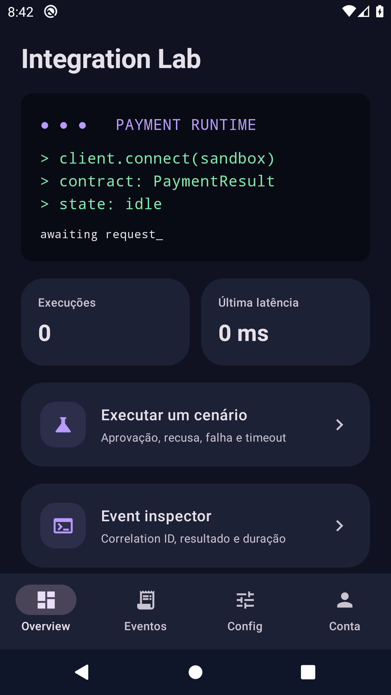
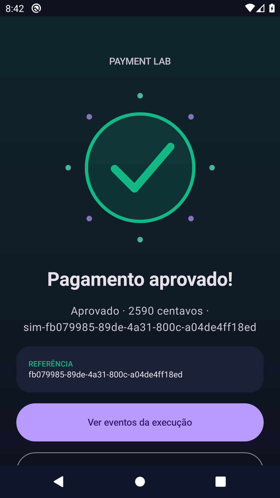

# Kotlin Payment SDK · Integration Lab

**SDK Kotlin independente de Android, acompanhado de um laboratório visual de integração.**

Projeto de **Bruno Breda · breda_dev**. Separar um protocolo de pagamento simulado da interface Android e tornar os cenários de falha reproduzíveis para quem integra um SDK.

**Plataforma:** Kotlin/JVM + sample Android · Compose  
**Estado:** implementação de portfólio em evolução; esteira aprovada na execução referenciada.

[Fluxos e demonstração](docs/fluxos.md) · [Engenharia](docs/engenharia.md) · [Builds e evidências](docs/evidencias.md) · [Portfólio completo](https://github.com/brunobredadeveloper/breda-park-wash/blob/main/docs/portfolio-breda-dev.md)

## O que você pode avaliar

- SDK Kotlin puro com contratos tipados e gateway substituível.
- Aprovação, recusa, indisponibilidade, timeout, cancelamento e conflito de idempotência.
- Sample Android com cenários, inspeção de eventos e configuração de latência/deadline.
- Autenticação opcional no sample, sem dependência de Firebase no SDK.

## Telas reais

Capturas do aplicativo executado em emulador Android, recuperadas dos artefatos da esteira. Não são mockups nem fotografias de um aparelho físico. A origem e os limites estão em [evidências](docs/evidencias.md).




## Fluxo principal

1. Abra o sample em modo local e execute um cenário aprovado.
2. Repita a chave mantendo o payload; observe o replay.
3. Reutilize a chave com valor diferente; observe o conflito.
4. Reduza o deadline em relação à latência para obter resultado desconhecido.
5. Compare os eventos e explique por que timeout não comprova recusa.

## Executar e validar

JDK 17. Para o sample: Android SDK 35 e Android 8+. O módulo Android só é incluído com -PincludeAndroid=true.

```sh
./gradlew :sdk:test :sdk:publishToMavenLocal
./gradlew -PincludeAndroid=true :sample-android:testDebugUnitTest :sample-android:lintDebug :sample-android:assembleDebug
```

Configuração, Firebase quando aplicável, assinatura e comandos adicionais: [referência técnica](docs/referencia-tecnica.md).

[Abrir a execução verificada no GitHub Actions](https://github.com/brunobredadeveloper/kotlin-payment-sdk/actions/runs/38172931037). A conclusão dessa execução é **success**; consulte os artefatos e a revisão de código em [evidências](docs/evidencias.md).

## Limites do produto

Não é um gateway de produção nem SDK certificado de adquirência. A idempotência da sessão não substitui garantia remota. Sem publicação declarada no Maven Central; publishToMavenLocal é validação local.

## Para quem revisa o portfólio

Equipes de SDKs, pagamentos e Android que precisam avaliar contratos, concorrência e resultados incertos. As [decisões de engenharia](docs/engenharia.md) conectam responsabilidades, arquivos e testes. O [roteiro funcional](docs/fluxos.md) ajuda a avaliar comportamento, falhas e preservação de dados. Funcionalidade planejada não é apresentada como implementada.

## Próximos passos

- Validar os percursos no dispositivo real e registrar os resultados.
- Revisar acessibilidade, interrupções e falhas de armazenamento/rede aplicáveis.
- Concluir requisitos de distribuição, suporte e segurança antes de uso comercial.

Código, mídias e dependências mantêm seus respectivos termos. Consulte os créditos e os avisos existentes no repositório.
