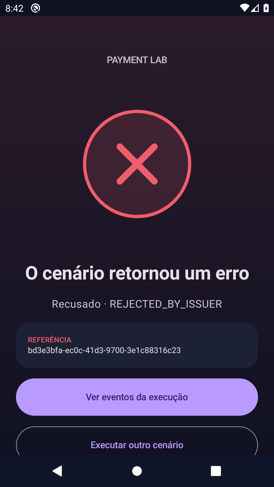

# Fluxos de uso — Kotlin Payment SDK · Integration Lab

Separar um protocolo de pagamento simulado da interface Android e tornar os cenários de falha reproduzíveis para quem integra um SDK.

## Mapa de telas

| Tela / área | O que a pessoa faz | Referência de implementação |
|---|---|---|
| Overview | Visualizar runtime e execuções da sessão. | [ProductWorkspace.kt](../sample-android/src/main/kotlin/dev/breda/payments/sample/ProductWorkspace.kt) |
| Executar cenário | Configurar requisição e cenário do simulador. | [PaymentExperiments.kt](../sample-android/src/main/kotlin/dev/breda/payments/sample/PaymentExperiments.kt) |
| Resultado | Inspecionar retorno tipado e feedback visual. | [PaymentViewModel.kt](../sample-android/src/main/kotlin/dev/breda/payments/sample/PaymentViewModel.kt) |
| Eventos | Acompanhar correlação e duração dos eventos em memória. | [ProductWorkspace.kt](../sample-android/src/main/kotlin/dev/breda/payments/sample/ProductWorkspace.kt) |
| Configuração e conta | Ajustar runtime e acesso do sample. | [AccountSession.kt](../sample-android/src/main/kotlin/dev/breda/payments/sample/AccountSession.kt) |

## Demonstração guiada

Use dados fictícios, em ambiente de avaliação.

1. Abra o sample em modo local e execute um cenário aprovado.
2. Repita a chave mantendo o payload; observe o replay.
3. Reutilize a chave com valor diferente; observe o conflito.
4. Reduza o deadline em relação à latência para obter resultado desconhecido.
5. Compare os eventos e explique por que timeout não comprova recusa.

## Casos que merecem atenção

- Cancelamento de coroutine precisa ser propagado.
- Timeout é incerteza: um gateway real pode ter concluído a autorização.
- Eventos do sample não constituem histórico persistente de servidor.

## Escopo e resultado esperado

Não é um gateway de produção nem SDK certificado de adquirência. A idempotência da sessão não substitui garantia remota. Sem publicação declarada no Maven Central; publishToMavenLocal é validação local.

## Galeria e contexto

As imagens abaixo representam um instante de uma execução automatizada. Uma captura estática não demonstra som, suavidade de animação, latência ou persistência.

### Painel inicial

### Resultado de sucesso

### Resultado de erro

## Checklist para validação do proprietário

- [ ] Instalar/abrir a versão correspondente às evidências.
- [ ] Percorrer a jornada principal e uma condição de falha.
- [ ] Confirmar navegação, retorno, teclado e leitura em tela pequena.
- [ ] Fechar/reabrir e verificar os dados que devem persistir.
- [ ] Avaliar os recursos nativos pertinentes no aparelho real.
- [ ] Registrar versão, aparelho, resultado esperado e observado em eventual relato.

[Voltar ao README](../README.md) · [Evidências](evidencias.md)
